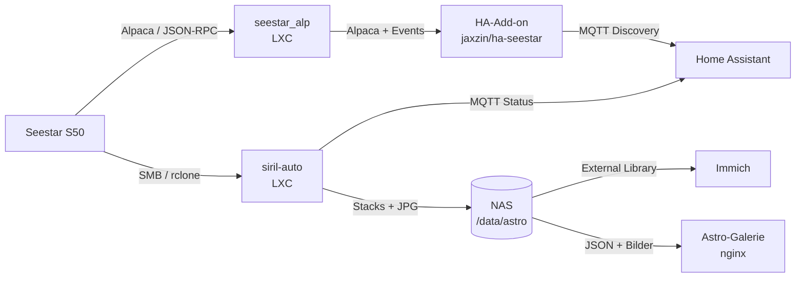

# seestar-astro-pipeline

Ein ZWO **Seestar S50** im Homelab: Steuerung und Telemetrie in **Home Assistant**, automatisches Stacking der Einzelframes mit **Siril**, Ablage auf dem NAS, Übergabe an **Immich** und eine eigene **Astro-Galerie** mit Objekt-Annotationen.

> **Status:** im Aufbau. seestar_alp und das HA-Add-on laufen. Die Siril-Pipeline ist geschrieben, aber noch nicht mit echten Seestar-Daten getestet. Die Galerie ist lauffähig, aktuell mit Beispieldaten (Bilder simuliert, Objektdaten und WCS real).

## Inhalt

| Ordner | Inhalt |
|---|---|
| [`docs/`](docs) | Einrichtung Schritt für Schritt: seestar_alp-LXC, HA-Add-on, Siril-LXC, Remote-Zugriff, Immich & Galerie, Astro-Pi, Roadmap |
| [`scripts/`](scripts) | Install-Scripte: seestar_alp auf amd64-LXC, Siril-LXC, Tailscale-LXC als Subnet-Router, Astro-Pi (Raspberry Pi) |
| [`siril/`](siril) | `siril-auto`: Abholung, Gruppierung nach Ziel/Filter/Nacht, Master-Stack, Plate-Solving, `meta.json`, systemd-Timer, MQTT-Status |
| [`tests/`](tests) | Tests ohne Siril und Teleskop (`python3 -m unittest discover -s tests`), laufen per GitHub Actions |
| [`homeassistant/`](homeassistant) | Dashboard-Karte, Packages **Astro-Audit** (KI-Empfehlung → Helfer → Automationen) und **Astro-Stacks** (Push mit Vorschaubild, Morgen-Zusammenfassung), Dashboard **Sternwarte** |
| [`pi/`](pi) | Astro-Pi: Montierung (iEXOS-100, NexStar) und EOS 6D über INDI, Web-App fürs Tablet mit GoTo, Serien, Live View, Plate-Solving |
| [`gallery/`](gallery) | Astro-Galerie: statisches Frontend, Builder (`meta.json` → Website), Beispieldaten, nginx-vhost |

## Komponenten

| Baustein | Projekt | Rolle |
|---|---|---|
| Treiber | [smart-underworld/seestar_alp](https://github.com/smart-underworld/seestar_alp) | ASCOM-Alpaca-Treiber und Web-UI (eigener LXC) |
| HA-Anbindung | [jaxzin/ha-seestar](https://github.com/jaxzin/ha-seestar) | Add-on im External-Modus, MQTT-Entities, abgesicherte Steuerung |
| Dashboard | [jaxzin/seestar-lovelace-card](https://github.com/jaxzin/seestar-lovelace-card) | Lovelace-Karte (HACS) |
| Stacking | [Siril](https://siril.org) | `siril-cli` mit [`siril/seestar_stack.ssf`](siril/seestar_stack.ssf) |
| Annotation | Siril `platesolve`/`conesearch`, astrometry.net `plot-constellations` | Objektpositionen für Galerie und Immich |

## Hinweise

- **Firmware ≥ 7.18:** Steuerbefehle brauchen einen Interop-Key in seestar_alp (ab 3.2.2). Telemetrie und Vorschau gehen ohne Key. Der Key gehört **nicht** in dieses Repository.
- Alle IPs, Hostnamen und Zugangsdaten in den Beispielen sind Platzhalter.

## Demo

Die Galerie mit Beispieldaten kann per GitHub Pages veröffentlicht werden (`.github/workflows/pages.yml`: Pages-Quelle „GitHub Actions“, Repo-Variable `ENABLE_PAGES=true`).

## Lizenz

[MIT](LICENSE) für die Inhalte dieses Repositorys. Die eingebundenen Projekte (seestar_alp: GPL-3.0, ha-seestar: Apache-2.0, Siril: GPL-3.0) behalten ihre eigenen Lizenzen und sind hier nicht enthalten. Der Katalog [OpenNGC](https://github.com/mattiaverga/OpenNGC) (CC-BY-SA 4.0) wird bei der Installation geladen; `tests/fixtures/ngc_subset.csv` ist ein Auszug daraus.
